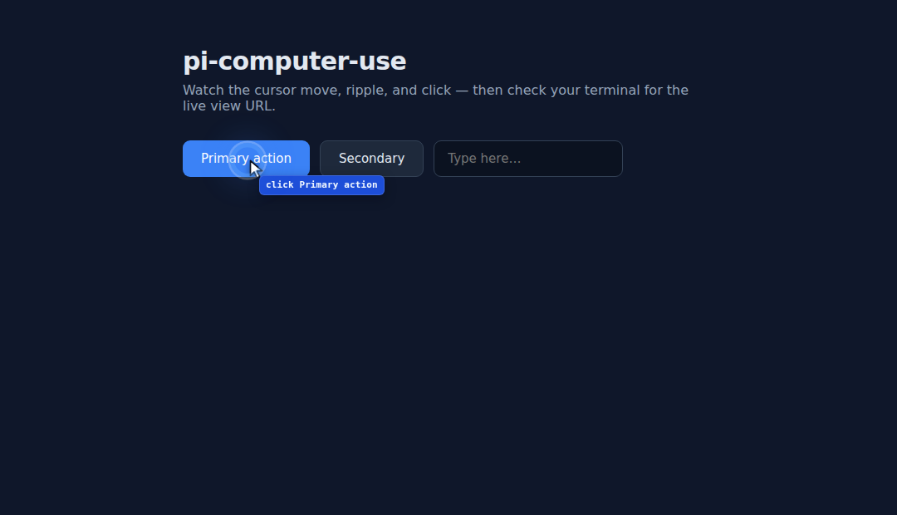
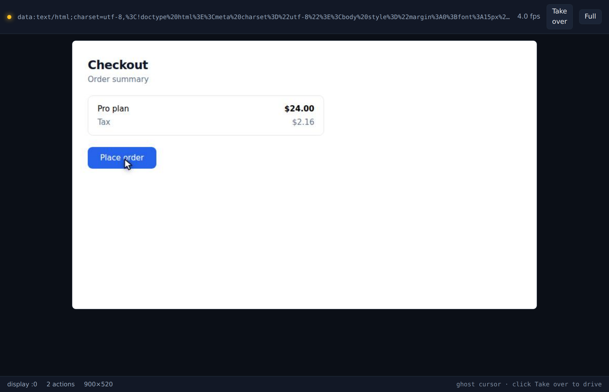

# pi-computer-use

**A browser Pi can drive that you can actually watch.**

Pi's browser automation runs headless, so every click happens in a window nobody
can see. This package runs a real headed Chromium instead, draws an animated
ghost cursor into the page, and streams the whole session to a viewer you open
locally — so you can follow along, catch a wrong click before it matters, and
trust what the agent did.



And the live view, streaming to your own browser:



```
   ┌─────────────────────────────┐        ┌──────────────────────┐
   │  headed Chromium            │        │  your browser        │
   │  ┌───────────────────────┐  │  SSE   │  ┌────────────────┐  │
   │  │ page + ghost cursor   │──┼───────▶│  │  live view     │  │
   │  │  ↖ animated pointer   │  │ frames │  │  click to take │  │
   │  └───────────────────────┘  │        │  │  over          │  │
   └─────────────────────────────┘        └──────────────────────┘
```

## Why

Codex's desktop app feels intuitive because the browser lives *inside* the window
you are already looking at, and on Windows it literally moves your OS pointer.
Pi had no equivalent: `@playwright/mcp` launches with `--headless`, its tools act
on accessibility refs, and nothing is ever drawn. The work was correct but
invisible.

This package closes that gap with three pieces:

| Piece | What it does |
| --- | --- |
| **Ghost cursor** | An animated pointer, click ripple, element highlight and action label drawn *inside the page*. |
| **Real input** | Every click and keypress goes through `page.mouse` / `page.keyboard`, so events stay `isTrusted: true`. The cursor annotates; it never substitutes. |
| **Live view** | A local web page streaming JPEG frames over SSE, with click-to-takeover. Works over SSH with one port forward. |

Optional fourth piece: `osPointer: true` moves the **real hardware cursor**
through X11 `XTest`, reproducing Codex's desktop takeover.

## Install

```bash
pi install git:github.com/haojun-mah/pi-computer-use
```

Then check the machine can run it:

```bash
npx pi-computer-use doctor
```

```
  ✓ node                 v22.19.0
  ✓ chromium             ~/.cache/ms-playwright/chromium-1223/chrome-linux64/chrome
  ✓ X display            :0 (found :0)
  ✓ real OS pointer      helper already built
  ✓ chromium smoke test  launches

Ready. The in-page ghost cursor works whenever Chromium + a display are present.
```

## Use

Just ask, or be explicit:

```
open a browser and show me the pricing page
```

The model gets nine tools:

| Tool | Purpose |
| --- | --- |
| `browser_open` | Launch the visible browser and load a URL. Returns the live view URL. |
| `browser_snapshot` | Page text plus interactive elements, each with a numeric `ref`. |
| `browser_click` | Move cursor → pause → ripple → real click. Takes a ref, selector, or `{x,y}`. |
| `browser_type` | Focus with a visible move, then type at a human cadence. |
| `browser_press` | Key or chord, e.g. `Enter`, `Control+A`. |
| `browser_scroll` | Scroll, optionally moving the cursor to a target first. |
| `browser_screenshot` | PNG back to the model, including the ghost cursor. |
| `browser_eval` | Evaluate JavaScript in the page. |
| `browser_close` | Close the browser and stop the stream. |

Plus `/browser` to print the live view URL, and `/browser --open` to launch it.

### Watching it

`browser_open` returns something like `http://127.0.0.1:7799/`. Open it locally.

Over SSH, forward the port first:

```bash
ssh -L 7799:127.0.0.1:7799 you@host
```

Then open `http://127.0.0.1:7799/` on your laptop. Toggle **Take over** to click
the stream and drive the page yourself; Pi keeps working from wherever the page
ended up.

## Targets

Prefer refs. They are stable within a snapshot and require no selector guessing:

```
browser_snapshot          →  [3] button "Add to cart" @412,286
browser_click {target:3}  →  clicked ref 3 "Add to cart" at 412,286
```

Refs are reassigned on each snapshot, so re-snapshot after navigation rather than
reusing an old one. CSS selectors and `{x, y}` are available for canvas, maps and
drag surfaces where nothing has a handle.

## Headless is still allowed

Set `headless: true` when nobody is watching. Everything works except the window;
the ghost cursor is still injected, so `browser_screenshot` stays legible and the
live view still streams. The stream is genuinely useful in CI: point a test at it
and you get a scrubbable record of what the agent saw.

## Requirements

- Node 20+
- Chromium — `npx playwright install chromium`, or any Chrome on the box
- A display for headed mode — `DISPLAY=:0`, a desktop session, or `Xvfb`
- *Optional:* a C compiler and `libXtst` for the real OS pointer

No root is required. No VNC server is required. No native addons are compiled at
install time.

## How it fits together

```
src/index.js      the extension: nine tools + /browser
src/session.js    BrowserSession: launch, serialized actions, snapshots
src/overlay.js    the in-page ghost cursor (injected at document start)
src/liveview.js   HTTP server: /, /stream (SSE), /frame.jpg, /input
src/os-pointer.js optional XTest helper, compiled once on first use
```

Actions are serialized through one queue so two clicks can never interleave — with
a human watching, overlapping cursors would be worse than slow ones. Frame grabs
deliberately bypass that queue: a dropped frame beats a stalled stream.

## Caveats

- The overlay lives in the page, so a page that replaces `document.documentElement`
  can drop it. It re-injects on the next navigation.
- `osPointer` assumes the browser window sits at its launch position; moving the
  window by hand offsets the hardware cursor.
- The live view binds to `127.0.0.1` only. It has no authentication, by design —
  forward the port, do not expose it.

## License

MIT
